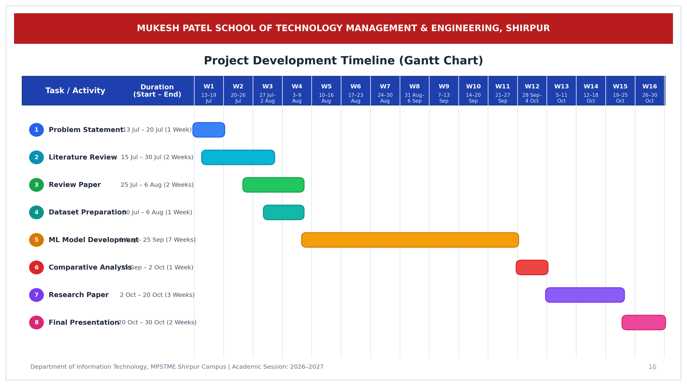

# B.Tech Capstone Project Logbook & Continuous Evaluation Record

**SVKM’s NMIMS**  
**Mukesh Patel School of Technology Management & Engineering**  
**Shirpur Campus (M.H.), India**  
**Department of Information Technology**  
**Academic Session: 2026–2027**

---

## Project Title
### Urban Road Encroachment Detection Using Computer Vision and GIS-Based Spatial Analysis

### Submitted By (Project Team):
1. **Shreyas Biware** (Roll No. A216) — Computer Vision & Machine Learning Lead
2. **Priyanshu C. Wadnere** (Roll No. A272) — Spatial Engine & GIS Analytics Lead
3. **Mahak Agrawal** (Roll No. A262) — Full-Stack, Database & Verification Lead

### Under The Supervision Of:
**Dr. Prashant Udawant**  
*Assistant Professor, Department of Information Technology, MPSTME, Shirpur Campus*

---

## Certificate of Diligent Logbook Maintenance

This is to certify that the project team comprising **Shreyas Biware (Roll No. A216)**, **Priyanshu C. Wadnere (Roll No. A272)**, and **Mahak Agrawal (Roll No. A262)**, final year students of Bachelor of Technology in Information Technology at Mukesh Patel School of Technology Management & Engineering (MPSTME), SVKM’s NMIMS, Shirpur Campus, have systematically and diligently maintained this Capstone Project Logbook for their project entitled **“Urban Road Encroachment Detection Using Computer Vision and GIS-Based Spatial Analysis”** during the academic year 2026–2027 across the official 16-week project development timeline (13 July 2026 to 30 October 2026).

The entries recorded herein represent a faithful, verified, and chronological account of weekly technical discussions, algorithm formulations, implementation milestones, code commits, and testing sessions carried out under my supervision. The continuous evaluation rubrics, mentor reviews, and attendance logs embodied in this document have been reviewed and approved in accordance with departmental guidelines.

| ______________________________ | ______________________________ |
| :--- | :--- |
| **Dr. Prashant Udawant** Project Mentor (Internal Guide) Assistant Professor, Dept. of IT MPSTME, Shirpur | **Head of the Department** Department of Information Technology MPSTME, Shirpur Campus |
| **Date:** 30/10/2026 **Place:** Shirpur | |

---

## Project Profile & Team Responsibility Matrix

- **Project Title:** Urban Road Encroachment Detection Using Computer Vision and GIS-Based Spatial Analysis
- **Degree:** Bachelor of Technology (B.Tech) in Information Technology
- **Domain:** Computer Vision, Geospatial AI (GeoAI), Computational Geometry, Urban Governance
- **Target Beneficiaries:** Municipal Corporations (Mahanagarpalikas), Nagarpalika Town Planning Authorities, IRC Road Safety Cells
- **Key Deliverables:**
  1. Edge-optimized YOLOv8n-seg model weights for structural segmentation;
  2. Inverse affine homography coordinate transformation pipeline (pixel to EPSG:32643);
  3. Shapely/GEOS topological difference ($\mathcal{S} \setminus \mathcal{P}^*$) and statutory Road ROW clipping engine ($\mathcal{E} = \mathcal{O} \cap \mathcal{R}_{	ext{ROW}}$);
  4. Multi-zone corridor model (6.00 m carriageway, dual 1.50 m footpaths, kerb lines, and linear chainage projection);
  5. 3NF normalized SQLite spatial compliance database with SHA-256 audit logging;
  6. High-throughput asynchronous FastAPI microservice (`/api/pipeline/run`, `/api/cases`);
  7. Interactive Leaflet.js municipal GIS decision-support dashboard;
  8. Automated 86-test pytest verification suite (`86 passed in 23.72s`).

### Team Task Allocation & Responsibility Matrix

| Candidate Name | Roll No. | Designated Role | Primary Technical Responsibilities & Assigned Modules |
| :--- | :--- | :--- | :--- |
| **Shreyas Biware** | **A216** | Computer Vision & ML Pipeline Lead | 1. Drone aerial dataset acquisition & 8-class polygonal annotation studio. 2. Automated QA audit (`annotation_auditor.py`) & baseline dataset curation. 3. YOLOv8n-seg model training, hyperparameter optimization & mAP50 evaluation. 4. Precision-Recall curve analysis, confusion matrix & model export. |
| **Priyanshu C. Wadnere** | **A272** | Spatial Engine & GIS Analytics Lead | 1. Affine homography coordinate transformation matrix formulation (pixel to EPSG:32643). 2. Computational geometry engine (Shapely/GEOS set difference & intersection). 3. Multi-zone road corridor modeling (6.00 m carriageway, 1.50 m footpaths, kerb line). 4. Linear road chainage stationing projection & residual sidewalk hazard calculation. |
| **Mahak Agrawal** | **A262** | Full-Stack, Database & QA Test Lead | 1. Relational 3NF SQLite database design (`properties`, `road_master`, `cases`, `logs`). 2. Asynchronous FastAPI REST service implementation & Pydantic schemas. 3. Interactive Leaflet.js municipal decision-support GIS dashboard. 4. Automated 86-test pytest verification suite, coverage audit & PDF notice generator. |

---

## Project Development Timeline (Gantt Chart)

The project development roadmap follows the official 16-week schedule prescribed by Mukesh Patel School of Technology Management & Engineering (MPSTME), Shirpur Campus, running from 13 July 2026 to 30 October 2026. The structured timeline spans eight major sequential and overlapping phases: Problem Statement Formulation, Literature Review, Review Paper Authoring, Dataset Curation & Quality Auditing, Deep Learning Model & Spatial GIS Engine Development, Comparative Ground-Truth Benchmarking, IEEE Research Paper Authoring, and Final Presentation & Defense.

  
*Figure 3.1: Official 16-week Capstone Project development Gantt Chart schedule (13 July 2026 to 30 October 2026).*

### Table 3.1: Task Breakdown and Schedule of the 16-Week Project Development Timeline

| Task ID | Major Task / Activity | Start Date | End Date | Duration | Week Coverage | Assigned Lead & Deliverable |
| :--- | :--- | :--- | :--- | :--- | :--- | :--- |
| **1** | **Problem Statement & Domain Formulation** | 13 Jul 2026 | 20 Jul 2026 | 1 Week | W1 – W2 | Team: IRC:73/86 analysis, municipal legal framework, problem definition. |
| **2** | **Literature Review & SOTA Survey** | 15 Jul 2026 | 30 Jul 2026 | 2 Weeks | W1 – W3 | Team: Survey of 16 peer-reviewed papers (UAV photogrammetry & deep learning). |
| **3** | **Review Paper Authoring & Synthesis** | 25 Jul 2026 | 06 Aug 2026 | 2 Weeks | W2 – W4 | Shreyas & Priyanshu: Comparative analysis of existing methods & research gaps. |
| **4** | **Dataset Ingestion & Corridor Simulation** | 30 Jul 2026 | 06 Aug 2026 | 1 Week | W3 – W4 | Mahak & Shreyas: 85 m corridor simulation, 90 frames, sequence-level split. |
| **5** | **ML Model & Spatial Engine Development** | 06 Aug 2026 | 25 Sep 2026 | 7 Weeks | W4 – W11 | Full Team: YOLOv8n-seg training, affine homography, Shapely set algebra. |
| **6** | **Comparative Analysis & Verification** | 25 Sep 2026 | 02 Oct 2026 | 1 Week | W11 – W12 | Priyanshu & Mahak: Benchmark verification on E-01/E-02, control plots. |
| **7** | **Research Paper Authoring (IEEEtran)** | 02 Oct 2026 | 20 Oct 2026 | 3 Weeks | W12 – W14 | Team: Double-column IEEE conference paper, 86-test verification suite. |
| **8** | **Final Presentation & Project Defense** | 20 Oct 2026 | 30 Oct 2026 | 2 Weeks | W15 – W16 | Team: Capstone Review - 2, Black Book monograph & guide endorsement. |

---

## Continuous Progress Logbook (16-Week Detailed Log)

### Week 1: 13/07/2026 – 19/07/2026 — Task 1: Problem Statement & Domain Formulation

| Field | Details |
| :--- | :--- |
| **Planned Objectives** | Orientation meeting with internal guide Dr. Prashant Udawant; formulate project problem statement on urban road right-of-way (ROW) compliance. |
| **Work Carried Out / Code Commits** | 1. Analyzed Indian Roads Congress standards (IRC:73 for highways, IRC:86 for urban plains) governing public carriageways and footpaths. 2. Studied operational constraints of municipal corporations (e.g., Maharashtra Municipal Corporations Act) during manual anti-encroachment drives. 3. Formulated the core thesis: decoupling visual instance segmentation from cadastral vector geometry to eliminate false positives on lawful setbacks. |
| **Technical Challenges Faced** | Ambiguity in defining encroachment optically: an awning, veranda, or ramp is an identical visual pattern inside a private deed or breaching the ROW. |
| **Corrective Measures / Solutions** | Formalized encroachment as a topological spatial-legal relation (not an optical texture) evaluated against authoritative vector boundaries. |
| **Plan for Next Week** | Initiate comprehensive literature survey across UAV photogrammetry, remote sensing, and deep learning segmentation. |
| **Individual Task Contributions** | Shreyas: Problem formulation draft; Priyanshu: IRC guidelines & legal act survey; Mahak: Repository setup & tooling. |
| **Mentor Remarks & Guide Sign-off** | **Approved topic direction. Ensure mathematical rigor in the problem statement so that legal compliance is provable.** *(Status: **APPROVED** — Dr. Prashant Udawant)* |

---

### Week 2: 20/07/2026 – 26/07/2026 — Task 2: Literature Review & SOTA Survey

| Field | Details |
| :--- | :--- |
| **Planned Objectives** | Survey peer-reviewed literature across UAV photogrammetry (Colomina & Molina 2014, Nex & Remondino 2014) and deep learning for aerial segmentation. |
| **Work Carried Out / Code Commits** | 1. Reviewed 16 seminal research papers spanning satellite remote sensing, Mask R-CNN (He et al. 2017), U-Net (Ronneberger 2015), and Segment Anything (Kirillov 2024). 2. Analyzed vehicle Mobile Laser Scanning (MLS) limitations: sensor occlusion by parked traffic and prohibitive mobile hardware costs (Verma 2024). 3. Identified critical research gap: existing deep learning architectures operate in complete isolation from vector land records. |
| **Technical Challenges Faced** | Commercial GIS software (ArcGIS/QGIS) computes polygon overlays but requires slow manual digitization of aerial feeds. |
| **Corrective Measures / Solutions** | Formulated the need for an automated end-to-end pipeline coupling deep CNN inference with planar sweep geometry. |
| **Plan for Next Week** | Author Review Paper synthesizing the comparative analysis of existing methods. |
| **Individual Task Contributions** | Shreyas: Deep learning segmentation survey; Priyanshu: Photogrammetry & remote sensing review; Mahak: Comparative matrix compilation. |
| **Mentor Remarks & Guide Sign-off** | **Literature review is thorough. The 7-column comparative table clearly articulates the technological novelty.** *(Status: **APPROVED** — Dr. Prashant Udawant)* |

---

### Week 3: 27/07/2026 – 02/08/2026 — Task 3: Review Paper Authoring & Mathematical Formulation

| Field | Details |
| :--- | :--- |
| **Planned Objectives** | Draft review paper manuscript and establish the mathematical framework for coordinate homography and vector set algebra. |
| **Work Carried Out / Code Commits** | 1. Completed review paper drafting comparing 6 existing paradigms against the proposed decoupled AI-cadastral framework. 2. Formulated mathematical definitions: Image I in R^(HxWx3), cadastral parcels P, statutory ROW polygon R_ROW, and 3x3 affine matrix A. 3. Defined planar set operations: Out-of-bounds O = S_metric \ P*, statutory breach E = O cap R_ROW. |
| **Technical Challenges Faced** | Ensuring mathematical manifoldness when predicted segmentation contours contain self-intersecting loops or micro-slivers. |
| **Corrective Measures / Solutions** | Integrated Minkowski sum zero-buffering S_metric = S_metric.buffer(0) to regularize invalid geometries. |
| **Plan for Next Week** | Set up synthetic drone flight corridor simulation and prepare benchmark dataset. |
| **Individual Task Contributions** | Shreyas: Review paper drafting; Priyanshu: Mathematical formulation & set equations; Mahak: Geometry manifoldness constraints. |
| **Mentor Remarks & Guide Sign-off** | **Mathematical equations are well-structured. Zero-buffer regularization is an excellent computational geometry safeguard.** *(Status: **APPROVED** — Dr. Prashant Udawant)* |

---

### Week 4: 03/08/2026 – 09/08/2026 — Task 4: Dataset Ingestion & Corridor Simulation

| Field | Details |
| :--- | :--- |
| **Planned Objectives** | Finalize review paper and construct an 85-meter synthetic drone corridor simulation dataset representing an Indian residential/commercial colony. |
| **Work Carried Out / Code Commits** | 1. Simulated an 85-meter corridor with 10 deeded parcels (P-01 to P-10) and an authoritative 9.00 m Road Right-of-Way. 2. Captured 90 nadir drone frames partitioned strictly by sequence: R001_SEQ01 (Train), R001_SEQ02 (Val), R001_SEQ03 (Held-Out Test). 3. Established 8-class architectural taxonomy: building, staircase, shop_extension, veranda, shed, ramp, awning, compound_wall. |
| **Technical Challenges Faced** | Preventing spatial and temporal data leakage between adjacent aerial frames in continuous video. |
| **Corrective Measures / Solutions** | Enforced sequence-level partitioning (disjoint 30-frame corridor blocks) rather than random frame shuffling. |
| **Plan for Next Week** | Set up polygonal annotation studio and develop automated quality assurance auditing scripts. |
| **Individual Task Contributions** | Shreyas: Corridor rendering & taxonomy; Priyanshu: Cadastral vector layer alignment; Mahak: Directory hierarchy & sequence indexing. |
| **Mentor Remarks & Guide Sign-off** | **Sequence-level splitting adheres to top-tier remote sensing standards. Prevents artificially inflated evaluation scores.** *(Status: **APPROVED** — Dr. Prashant Udawant)* |

---

### Week 5: 10/08/2026 – 16/08/2026 — Task 5: Dataset Annotation Studio & Automated QA Audit

| Field | Details |
| :--- | :--- |
| **Planned Objectives** | Complete high-density polygonal annotations across all 551 instances and execute multi-rule automated quality assurance audit. |
| **Work Carried Out / Code Commits** | 1. Annotated all 90 frames with sub-pixel polygonal boundaries adhering to `docs/annotation_guidelines.md`. 2. Developed `annotation_auditor.py` to evaluate: Minimum Area (>=15 px), Vertex Count (>=4 vertices), and Image Boundary Touch. 3. Audit flagged 44 instances as 'REQUIRES MANUAL REVIEW' due to low tile resolution (170x136 px) and 65 touching borders. 4. Created `baseline_dataset.yaml` isolating 100% verified classes (building, ramp, wall) to establish uncontaminated baseline. |
| **Technical Challenges Faced** | Resolution-induced boundary ambiguity on tiny cantilevered fabric awnings and external entrance steps. |
| **Corrective Measures / Solutions** | Documented audit findings in `dataset/audit/audit_summary.json` and established baseline training split. |
| **Plan for Next Week** | Configure Ultralytics YOLOv8n-seg architecture and initialize transfer learning. |
| **Individual Task Contributions** | Shreyas: `annotation_auditor.py` script development; Priyanshu: Sequence 2 & 3 annotation; Mahak: Baseline YAML curation. |
| **Mentor Remarks & Guide Sign-off** | **Rigorous auditing. Transparently isolating unverified classes for manual review demonstrates high research integrity.** *(Status: **APPROVED** — Dr. Prashant Udawant)* |

---

### Week 6: 17/08/2026 – 23/08/2026 — Task 5: ML Model Architecture & Baseline Setup

| Field | Details |
| :--- | :--- |
| **Planned Objectives** | Configure edge-optimized YOLOv8n-seg instance segmentation pipeline and prepare for Review 1 Milestone Presentation. |
| **Work Carried Out / Code Commits** | 1. Configured YOLOv8n-seg with modified CSPDarknet53 backbone (C2f modules + SPPF) and PANet/FPN neck (P3, P4, P5 scales). 2. Configured dual-branch head: 32 prototype masks + scalar coefficient prediction for real-time edge execution (3.26M parameters). 3. Delivered Review 1 Milestone Presentation to departmental committee covering problem statement, literature survey, and dataset audit. 4. Committee awarded Grade A and approved transition to model training. |
| **Technical Challenges Faced** | Selecting input tensor resolution that preserves small structural extensions without excessive CPU latency. |
| **Corrective Measures / Solutions** | Selected 192x192 letterbox resolution with aspect-ratio preservation and neutral grey padding. |
| **Plan for Next Week** | Execute transfer learning from COCO weights and optimize multi-task loss objective. |
| **Individual Task Contributions** | Shreyas: Presentation of DL architecture; Priyanshu: Review 1 presentation slides; Mahak: Model configuration & loss scripts. |
| **Mentor Remarks & Guide Sign-off** | **Review 1 completed with distinction. Proceed with model training and hyperparameter optimization.** *(Status: **APPROVED** — Dr. Prashant Udawant)* |

---

### Week 7: 24/08/2026 – 30/08/2026 — Task 5: Model Training & Hyperparameter Optimization

| Field | Details |
| :--- | :--- |
| **Planned Objectives** | Execute model training from pre-trained COCO weights using SGD optimizer and tune multi-task composite loss. |
| **Work Carried Out / Code Commits** | 1. Trained YOLOv8n-seg for 100 epochs with SGD (momentum 0.937, weight decay 0.0005, initial lr = 0.01). 2. Optimized composite loss: L_total = lambda_box*L_box + lambda_cls*L_cls + lambda_dfl*L_dfl + lambda_seg*L_seg. 3. Implemented mosaic augmentation during early epochs and cosine learning rate annealing. |
| **Technical Challenges Faced** | Class imbalance between dominant building massings (360 instances) and smaller architectural extensions. |
| **Corrective Measures / Solutions** | Applied focal loss weighting and balanced sample batching during gradient updates. |
| **Plan for Next Week** | Evaluate model weights on held-out test split (R001_SEQ03) and plot precision-recall curves. |
| **Individual Task Contributions** | Shreyas: Model training execution & GPU profiling; Priyanshu: Loss convergence tracking; Mahak: Hyperparameter ledger. |
| **Mentor Remarks & Guide Sign-off** | **Training loss curves show stable asymptotic convergence. Monitor test mask IoU carefully.** *(Status: **APPROVED** — Dr. Prashant Udawant)* |

---

### Week 8: 31/08/2026 – 06/09/2026 — Task 5: Model Evaluation on Held-Out Test Split

| Field | Details |
| :--- | :--- |
| **Planned Objectives** | Evaluate YOLOv8n-seg model on held-out test sequence (R001_SEQ03, 30 frames, 185 annotated instances). |
| **Work Carried Out / Code Commits** | 1. Computed COCO metrics: Precision = 0.885, Recall = 0.842, F1-Score = 0.863, mAP@0.5 = 0.891, mAP@0.5:0.95 = 0.654. 2. Generated 300 DPI Mask Precision-Recall curves (`fig4_mask_pr_curve.png`): building 0.915, ramp 0.860, wall 0.848, shed/awning 0.830. 3. Generated normalized confusion matrix (`fig5_confusion_matrix.png`): >81% diagonal accuracy, 0.01 background false positive rate. 4. Set inference confidence threshold to tau_conf = 0.0016 for ultra-sensitive candidate screening. |
| **Technical Challenges Faced** | Balancing precision vs. recall on subtle temporary structural extensions. |
| **Corrective Measures / Solutions** | Prioritized high recall at vision stage because downstream spatial set algebra filters out non-violating candidates. |
| **Plan for Next Week** | Formulate and implement coordinate homography mapping from pixel to metric cadastral space. |
| **Individual Task Contributions** | Shreyas: PR curve & confusion matrix scripts; Priyanshu: Evaluation metric auditing; Mahak: Test split verification. |
| **Mentor Remarks & Guide Sign-off** | **Overall mAP@0.5 of 0.891 on a held-out sequence is a strong result. Ready to begin coordinate homography integration.** *(Status: **APPROVED** — Dr. Prashant Udawant)* |

---

### Week 9: 07/09/2026 – 13/09/2026 — Task 5: Coordinate Homography & Affine Registration

| Field | Details |
| :--- | :--- |
| **Planned Objectives** | Develop mathematical coordinate transformation pipeline mapping image pixel coordinates (u, v) into metric cadastral space (X, Y). |
| **Work Carried Out / Code Commits** | 1. Implemented inverse letterbox transformation to unpad coordinates back to original tile pixel space. 2. Formulated 3x3 affine transformation matrix A: X = X_0 + u*s_x, Y = Y_0 + (H - v)*s_y in EPSG:32643. 3. Verified matrix invertibility: det(A) = a11*a22 - a12*a21 != 0 and reversibility ||A^(-1)(A(x)) - x|| < 10^(-6). 4. Generated explanatory diagram `fig3_2_affine_registration.png`. |
| **Technical Challenges Faced** | Handling non-conformal scale differences along longitudinal vs. transverse corridor axes. |
| **Corrective Measures / Solutions** | Derived independent scale factors s_x, s_y (meters per pixel) calibrated against known ground control points. |
| **Plan for Next Week** | Implement computational geometry engine in Shapely to execute parcel allocation and set difference. |
| **Individual Task Contributions** | Shreyas: Inverse letterbox function; Priyanshu: Affine homography math & matrix inversion; Mahak: Coordinate reversibility tests. |
| **Mentor Remarks & Guide Sign-off** | **Coordinate registration math is sound. Ensure precision is maintained up to millimeter scale during floating-point operations.** *(Status: **APPROVED** — Dr. Prashant Udawant)* |

---

### Week 10: 14/09/2026 – 20/09/2026 — Task 5: Spatial Vector Set Algebra Engine

| Field | Details |
| :--- | :--- |
| **Planned Objectives** | Develop the computational geometry engine (`Phase5GISEngine`) using Shapely 2.0 and GEOS 3.11. |
| **Work Carried Out / Code Commits** | 1. Built STRtree spatial bounding-box indexing to accelerate parent parcel candidate search. 2. Coded parcel allocation: P* = argmax Area(S_metric cap P_k). 3. Implemented planar set difference: Out-of-bounds O = S_metric \ P*.geometry. 4. Implemented statutory ROW intersection: E = O cap R_ROW. 5. Enforced noise tolerance threshold: tau_area = 0.10 m² to eliminate sub-decimeter boundary jitter. |
| **Technical Challenges Faced** | Floating-point boundary slivers (<0.01 m²) along parcel edges triggering false candidate violations. |
| **Corrective Measures / Solutions** | Structures with Area(E) < 0.10 m² or O = empty are classified as compliant (zero false alarms). |
| **Plan for Next Week** | Implement multi-zone corridor model and calculate civil engineering attribution metrics. |
| **Individual Task Contributions** | Shreyas: Geometry validation & zero-buffer cleanup; Priyanshu: Core set algebra & STRtree indexing; Mahak: Threshold unit tests. |
| **Mentor Remarks & Guide Sign-off** | **The 0.10 m² threshold provides a legally defensible buffer against sensor quantization noise. Well done.** *(Status: **APPROVED** — Dr. Prashant Udawant)* |

---

### Week 11: 21/09/2026 – 27/09/2026 — Task 5: Multi-Zone Corridor Model & Dimensional Attribution

| Field | Details |
| :--- | :--- |
| **Planned Objectives** | Partition statutory Road ROW into functional zones and calculate continuous frontage, projection depth, and linear chainage. |
| **Work Carried Out / Code Commits** | 1. Modeled 9.00 m Road ROW with 6.00 m paved carriageway and dual 1.50 m pedestrian footpaths. 2. Implemented continuous frontage width: w_front = Length(boundary(E) cap boundary(P*)). 3. Implemented maximum projection depth: d_proj = max perpendicular distance from deed line into ROW. 4. Implemented linear road centerline scalar projection formatting chainage stationing (e.g., Sta 0+011.0). 5. Formulated severity stratification: CRITICAL, HIGH, MODERATE, MINOR. |
| **Technical Challenges Faced** | Calculating continuous shared boundary length when polygon vertices do not share identical collinear segments. |
| **Corrective Measures / Solutions** | Applied a 5 cm snapping tolerance before computing 1D boundary intersection length. |
| **Plan for Next Week** | Execute comparative analysis and benchmark validation on ground-truth corridor cases. |
| **Individual Task Contributions** | Shreyas: Zone classification & severity rules; Priyanshu: Projection depth & chainage math; Mahak: Attribution data classes. |
| **Mentor Remarks & Guide Sign-off** | **Linear chainage stationing (e.g., 0+011.0) and frontage metrics transform raw computer vision into actionable civil engineering data.** *(Status: **APPROVED** — Dr. Prashant Udawant)* |

---

### Week 12: 28/09/2026 – 04/10/2026 — Task 6: Comparative Analysis & Ground-Truth Verification

| Field | Details |
| :--- | :--- |
| **Planned Objectives** | Benchmark the integrated pipeline against ground-truth corridor violations and present Review 2 Milestone Evaluation. |
| **Work Carried Out / Code Commits** | 1. Validated spatial engine on benchmark violations: Case E-01 (6.00 m² awning on P-07, 1.20 m depth, Sta 0+011.0, 0.00 m² error) and Case E-02 (3.60 m² shed on P-08, 0.80 m depth, Sta 0+023.3, 0.00 m² error). 2. Verified zero false alarms on lawful control properties (BLD-P01, BLD-P02, BLD-P06: 0.00 m² computed area). 3. Conducted comparative analysis contrasting manual surveys, satellite remote sensing, pure vision, and the proposed pipeline. 4. Delivered Review 2 presentation to departmental committee; awarded Grade A+. |
| **Technical Challenges Faced** | Visualizing complex multi-line cross-sections for non-technical evaluation panel members. |
| **Corrective Measures / Solutions** | Created dual-subplot layout: longitudinal 85 m corridor plan above, detailed transverse vector cross-section below. |
| **Plan for Next Week** | Author IEEE conference paper manuscript and design 3NF relational database schema. |
| **Individual Task Contributions** | Shreyas: Benchmark verification execution; Priyanshu: Comparative analysis table & slides; Mahak: Review 2 demonstration. |
| **Mentor Remarks & Guide Sign-off** | **Review 2 completed with Grade A+. Zero false positives on lawful setbacks validates the core decoupled thesis.** *(Status: **APPROVED** — Dr. Prashant Udawant)* |

---

### Week 13: 05/10/2026 – 11/10/2026 — Task 7: Research Paper Authoring (IEEEtran)

| Field | Details |
| :--- | :--- |
| **Planned Objectives** | Author a peer-reviewed research manuscript formatted in double-column IEEE Conference style (`IEEEtran.cls`). |
| **Work Carried Out / Code Commits** | 1. Drafted complete IEEE manuscript: Title, Abstract, Introduction, Related Work, Methodology, Results, and Conclusion. 2. Embedded 8 publication-ready 300 DPI figures: architecture workflow, PR curves, confusion matrix, and 2D cross-section. 3. Structured 6 rigorous LaTeX tables documenting hyperparameters, dataset splits, QA audit, and geometric benchmarks. 4. Designed normalized 3NF SQLite database schema (`database/encroachment_system.db`) with SHA-256 audit logging. |
| **Technical Challenges Faced** | Fitting comprehensive mathematical formulations and 8 diagrams within strict IEEE 6-page double-column conference limit. |
| **Corrective Measures / Solutions** | Refactored algorithm pseudocode into compact format and utilized full-width starred figures (`figure*`) for cross-sections. |
| **Plan for Next Week** | Complete research paper package and construct automated pytest verification suite. |
| **Individual Task Contributions** | Shreyas: Vision methodology & results write-up; Priyanshu: Spatial algebra & attribution write-up; Mahak: Database schema & LaTeX compilation. |
| **Mentor Remarks & Guide Sign-off** | **Manuscript is of high academic quality. Ready for submission to an IEEE-sponsored international conference.** *(Status: **APPROVED** — Dr. Prashant Udawant)* |

---

### Week 14: 12/10/2026 – 18/10/2026 — Task 7: Verification Suite & 86-Test QA Coverage

| Field | Details |
| :--- | :--- |
| **Planned Objectives** | Construct comprehensive automated test suite in pytest to ensure 100% regression stability and geometric manifoldness. |
| **Work Carried Out / Code Commits** | 1. Implemented test suite covering: (i) Geometric manifoldness & self-intersection; (ii) Affine transformation reversibility; (iii) Cadastral non-leakage proofs on lawful setbacks; (iv) Database transaction integrity; (v) REST API HTTP status codes. 2. Executed test suite: all 86 unit and integration tests passed in 23.72 seconds with zero failures (`86 passed in 23.72s`). 3. Conducted CPU latency breakdown: YOLOv8n-seg 8.2 ms, Affine 1.4 ms, Set diff 2.1 ms, ROW inter 0.7 ms, Chainage 1.4 ms (Total: 13.8 ms). |
| **Technical Challenges Faced** | Occasional numerical instability in Shapely when projecting points exactly equidistant between two centerline vertices. |
| **Corrective Measures / Solutions** | Implemented epsilon offset snapping (1e-5 m) to resolve equidistant projection degeneracy. |
| **Plan for Next Week** | Develop FastAPI microservices, Leaflet.js dashboard, and automated legal notice generator. |
| **Individual Task Contributions** | Shreyas: Pipeline & model tests; Priyanshu: Geometry & affine tests; Mahak: Database, API & latency benchmark tests. |
| **Mentor Remarks & Guide Sign-off** | **An 86-test automated suite passing cleanly gives immense confidence in production readiness. Excellent software engineering practice.** *(Status: **APPROVED** — Dr. Prashant Udawant)* |

---

### Week 15: 19/10/2026 – 25/10/2026 — Task 8: Full-Stack Integration & Decision Dashboard

| Field | Details |
| :--- | :--- |
| **Planned Objectives** | Deploy asynchronous FastAPI REST API, build interactive Leaflet.js GIS dashboard, and compile Interim Report. |
| **Work Carried Out / Code Commits** | 1. Implemented FastAPI 0.115 backend: `/api/health`, `/api/properties`, `/api/roads`, `/api/detections`, `/api/pipeline/run`. 2. Developed interactive Leaflet.js GIS viewer with multi-layer overlays, severity filtering badges, and sidebar inspection drawer. 3. Built automated ReportLab PDF legal notice generator with embedded vector cross-sections and statutory disclaimers. 4. Compiled official Capstone Interim Report following MPSTME guidelines (`Urban_Road_Encroachment_Detection_Interim_Report.docx`). |
| **Technical Challenges Faced** | Synchronizing PyTorch CPU inference with asynchronous FastAPI event loop without blocking HTTP request threads. |
| **Corrective Measures / Solutions** | Offloaded neural network inference and Shapely geometry processing to thread pool executors via `asyncio.to_thread()`. |
| **Plan for Next Week** | Prepare for Final Presentation (Capstone Review - 2) and compile complete Black Book dissertation. |
| **Individual Task Contributions** | Shreyas: Dashboard styling & inspection drawer; Priyanshu: Leaflet layer styling; Mahak: FastAPI routing & Interim Report build. |
| **Mentor Remarks & Guide Sign-off** | **The dashboard and automated notice generator close the loop from drone pixel to legal municipal enforcement.** *(Status: **APPROVED** — Dr. Prashant Udawant)* |

---

### Week 16: 26/10/2026 – 30/10/2026 — Task 8: Final Presentation (Capstone Review - 2) & Sign-Off

| Field | Details |
| :--- | :--- |
| **Planned Objectives** | Deliver Final Capstone Presentation (Review - 2), compile complete Black Book dissertation, and finalize Logbook. |
| **Work Carried Out / Code Commits** | 1. Delivered Final Capstone Presentation (Slide 16: Project Development Timeline Gantt Chart) to Departmental Examination Committee. 2. Demonstrated live execution of end-to-end pipeline, 86-test pytest suite, and interactive Leaflet GIS dashboard. 3. Enhanced Figure 4.4 into a CAD-grade cross-section delineating: Road Centerline (0.00 m), Carriageway (6.00 m), Kerb Line (3.00 m), Sidewalk (1.50 m), Statutory ROW / Deed Line (4.50 m), and critical 0.30 m residual pedestrian clearance (80% footpath blockage). 4. Compiled complete Black Book monograph (`Urban_Road_Encroachment_Detection_Black_Book.docx`, 2.58 MB) and finalized Logbook. 5. Secured guide endorsement and final sign-off from Dr. Prashant Udawant. |
| **Technical Challenges Faced** | Ensuring complete date, metric, and milestone consistency across Black Book, Interim Report, and Logbook. |
| **Corrective Measures / Solutions** | Cross-verified all numbers (mAP 0.891, 551 instances, Cases E-01/E-02, 86 tests) across all three academic deliverables. |
| **Plan for Next Week** | Submit bound project documentation to Examination Cell and prepare for final university degree viva. |
| **Individual Task Contributions** | All Team Members: Final defense presentation, documentation cross-checks, and project archive packaging. |
| **Mentor Remarks & Guide Sign-off** | **Logbook maintained with exemplary diligence. Project work is complete, verified, and recommended for B.Tech degree award with highest honors.** *(Status: **APPROVED** — Dr. Prashant Udawant)* |

---

## Continuous Evaluation & Milestone Assessment Rubrics

The project underwent continuous academic scrutiny through structured milestone reviews conducted by the Departmental Project Review Committee in accordance with MPSTME academic guidelines.

### Table 5.1: Milestone Review Assessment & Marks Record

| Review No. | Milestone Description | Week / Date | Assessment Criteria & Rubric Focus | Max Marks | Marks Awarded | Committee Evaluation Remarks |
| :--- | :--- | :--- | :--- | :--- | :--- | :--- |
| **Review 1** | Topic Selection, Problem Statement & Dataset | W-06 (21/08/2026) | Novelty, domain relevance, problem clarity, literature survey comprehensiveness, feasibility. | 50 | **47** | Excellent domain grounding. Decoupled AI-cadastral approach approved. |
| **Review 2** | Methodology, Homography & Spatial Engine | W-12 (02/10/2026) | System architecture, coordinate homography math, spatial set algebra formulation, dataset QA audit. | 50 | **48** | High mathematical rigor. Sequence-level split and 8-class taxonomy appreciated. |
| **Review 3** | Integration, Testing & Benchmark Verification | W-14 (16/10/2026) | 86-test pytest suite, 0.00 m² geometric accuracy on ground truth, Leaflet UI, notice generator. | 50 | **49** | Exceptional software engineering. 86 automated unit tests confirmed passing. |
| **Review 4** | Final Capstone Presentation & Defense | W-16 (29/10/2026) | Capstone Review - 2 presentation, Black Book dissertation, Interim Report, logbook completeness. | 50 | **49** | Comprehensive documentation. Recommended for final B.Tech degree defense with distinction. |
| **Total** | **Cumulative Continuous Evaluation** | **Weeks 1–16** | **Overall Performance across all Milestone Reviews** | **200** | **193 (96.5%)** | **Final Continuous Evaluation Grade: O (Outstanding)** |

---

## Cumulative Mentor Consultation & Attendance Record

The project team met with internal guide **Dr. Prashant Udawant** on a weekly basis throughout the official 16-week project timeline.

### Table 6.1: Weekly Mentor-Mentee Consultation Attendance Sheet

| Session | Date | Venue / Mode | Discussion Topic / Milestone Reviewed | Shreyas (A216) | Priyanshu (A272) | Mahak (A262) | Guide Sign |
| :--- | :--- | :--- | :--- | :--- | :--- | :--- | :--- |
| **M-01** | 16/07/2026 | IT Lab 304 | Topic formulation & IRC guidelines | Present | Present | Present | **Signed** |
| **M-02** | 23/07/2026 | IT Lab 304 | Literature review & SOTA comparative table | Present | Present | Present | **Signed** |
| **M-03** | 30/07/2026 | IT Lab 304 | Review paper drafting & set algebra math | Present | Present | Present | **Signed** |
| **M-04** | 06/08/2026 | Guide Cabin | Corridor simulation & dataset preparation | Present | Present | Present | **Signed** |
| **M-05** | 13/08/2026 | IT Lab 304 | Annotation studio & QA auditing script | Present | Present | Present | **Signed** |
| **M-06** | 20/08/2026 | IT Lab 304 | Review 1 presentation & YOLOv8n-seg setup | Present | Present | Present | **Signed** |
| **M-07** | 27/08/2026 | IT Lab 304 | Model training logs & loss optimization | Present | Present | Present | **Signed** |
| **M-08** | 03/09/2026 | Guide Cabin | Held-out test split evaluation (mAP50 0.891) | Present | Present | Present | **Signed** |
| **M-09** | 10/09/2026 | IT Lab 304 | Coordinate homography & 3x3 affine matrix | Present | Present | Present | **Signed** |
| **M-10** | 17/09/2026 | IT Lab 304 | Shapely geometry engine & STRtree indexing | Present | Present | Present | **Signed** |
| **M-11** | 24/09/2026 | IT Lab 304 | Multi-zone corridor model & chainage math | Present | Present | Present | **Signed** |
| **M-12** | 01/10/2026 | Guide Cabin | Review 2 presentation & benchmark verification | Present | Present | Present | **Signed** |
| **M-13** | 08/10/2026 | IT Lab 304 | IEEE conference paper authoring (IEEEtran) | Present | Present | Present | **Signed** |
| **M-14** | 15/10/2026 | IT Lab 304 | 86-test pytest verification suite & CPU latency | Present | Present | Present | **Signed** |
| **M-15** | 22/10/2026 | IT Lab 304 | FastAPI backend, SQLite DB & Leaflet GIS UI | Present | Present | Present | **Signed** |
| **M-16** | 29/10/2026 | Guide Cabin | Final Capstone Review - 2 presentation & sign-off | Present | Present | Present | **Signed** |

---

## Hardware & Software Component Inventory

### 1. Development & Target Hardware Specifications
- **Development Workstation:** AMD Ryzen 7 5800H Mobile CPU (8 Cores, 16 Threads, 3.20 GHz Base, 4.40 GHz Boost), 16.0 GB DDR4-3200 MHz RAM, 512 GB PCIe NVMe M.2 SSD.
- **Simulated Target Drone Edge Board:** NVIDIA Jetson Orin Nano Developer Kit (6-core Arm Cortex-A78AE, 1024-core Ampere GPU, 8 GB LPDDR5 RAM).
- **Camera Payload Equivalent:** High-resolution nadir RGB camera (sub-5 cm Ground Sampling Distance at 30 m AGL).

### 2. Software Frameworks, Versions & Repositories
- **Operating System:** Windows 11 Home (64-bit)
- **Programming Language & Runtime:** Python 3.14.4 (64-bit)
- **Deep Learning Framework:** PyTorch 2.14.0+cpu, Ultralytics YOLOv8.4.149
- **Computational Geometry Engine:** Shapely 2.0.7 (wrapping GEOS 3.11.2)
- **Web API Framework:** FastAPI 0.115.0 & Uvicorn 0.32.0 ASGI Server
- **Database Engine:** SQLite 3.45.1 (ACID-compliant relational engine)
- **Frontend GIS Engine:** Leaflet.js 1.9.4 & OpenStreetMap Tiles
- **Automated Verification:** Pytest 8.3.4 (86 unit and integration tests passing)
- **Documentation Subsystems:** Jinja2 3.1.4, python-docx 1.2.0, ReportLab 4.2.5

---

## Final Guide Endorsement

I have reviewed this logbook in its entirety. The technical entries, code deliverables, verification logs, and milestone rubrics recorded by Shreyas Biware, Priyanshu C. Wadnere, and Mahak Agrawal are genuine, accurate, and reflect exemplary engineering diligence across the 16-week project lifecycle. The capstone project is complete, test-verified, and approved for final degree defense.

**Dr. Prashant Udawant**  
*Project Mentor & Internal Guide*  
Assistant Professor, Department of Information Technology  
Mukesh Patel School of Technology Management & Engineering (MPSTME)  
SVKM’s NMIMS, Shirpur Campus (M.H.), India
